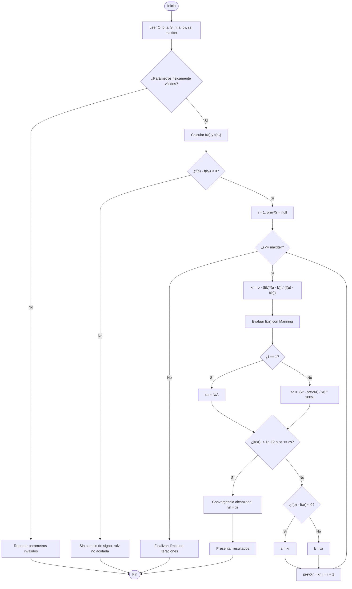

# Informe Académico: Cálculo del Tirante Normal en un Canal Trapezoidal Mediante el Método de Falsa Posición

**Proyecto:** HydroSolve  
**Asignatura:** Métodos Numéricos  
**Área de aplicación:** Ingeniería Civil — Hidráulica de Canales Abiertos  
**Fecha:** Octubre de 2026  

---

## 1. Introducción

En el diseño de obras hidráulicas a superficie libre (como canales de riego, drenajes pluviales y conducciones de trasvase), el cálculo del **tirante normal** ($y_n$) es una de las tareas más comunes. El tirante normal corresponde a la profundidad del agua cuando el flujo es uniforme y permanente, es decir, cuando la componente del peso del fluido en la dirección del flujo se equilibra con las fuerzas de fricción contra las paredes y el fondo del canal.

La relación entre el caudal transportado ($Q$), la pendiente de la rasante ($S$), la rugosidad del revestimiento ($n$) y la geometría transversal se describe habitualmente mediante la **ecuación de Manning**. En canales trapezoidales, tanto el área mojada como el perímetro mojado son funciones no lineales del tirante $y$. Al combinarse en la expresión del caudal ($A \cdot R^{2/3}$), la variable $y$ queda contenida en exponentes fraccionarios que impiden un despeje analítico directo.

Este informe presenta la formulación del problema como una ecuación no lineal de una variable, la aplicación paso a paso del método numérico de **falsa posición (Regula Falsi)** para encontrar el tirante normal, el análisis del comportamiento del algoritmo y la interpretación de los resultados en términos de ingeniería civil.

---

## 2. Planteamiento del problema

Se requiere determinar el tirante normal en un canal trapezoidal revestido en concreto que transporta un caudal de diseño especificado en régimen uniforme permanente.

### Parámetros de diseño:

| Parámetro | Símbolo | Valor | Unidades | Descripción |
| :--- | :---: | :---: | :---: | :--- |
| Caudal de diseño | $Q$ | $12,00$ | $\text{m}^3/\text{s}$ | Gasto volumétrico a conducir |
| Ancho de fondo | $b$ | $3,00$ | $\text{m}$ | Base del canal trapezoidal |
| Talud lateral | $z$ | $1,50$ | $\text{H:1V}$ | Relación horizontal a vertical |
| Pendiente longitudinal | $S$ | $0,001$ | $\text{m/m}$ | Inclinación del fondo del canal |
| Coeficiente de Manning | $n$ | $0,025$ | $\text{s/m}^{1/3}$ | Rugosidad de concreto rugoso |
| Extremo inferior inicial | $a$ | $1,00$ | $\text{m}$ | Cota inferior del intervalo de búsqueda |
| Extremo superior inicial | $b_0$ | $2,00$ | $\text{m}$ | Cota superior del intervalo de búsqueda |
| Tolerancia de error relativo | $\varepsilon_s$ | $0,01$ | $\%$ | Criterio de parada del algoritmo |

> **Nota sobre la notación:** El símbolo $b_0 = 2,00\text{ m}$ representa el límite superior del intervalo numérico de búsqueda, para no confundirlo con el ancho de fondo del canal $b = 3,00\text{ m}$.

---

## 3. Objetivos

### 3.1. Objetivo general
Determinar numéricamente el tirante normal en un canal trapezoidal mediante el método de falsa posición a partir de la ecuación de Manning, analizando el proceso de convergencia y el significado físico de la solución.

### 3.2. Objetivos específicos
1. Formular la función objetivo no lineal $f(y) = Q_c(y) - Q$ a partir de la geometría del canal y la ley de resistencia de Manning.
2. Verificar la existencia de raíz en el intervalo inicial $[a, b_0]$ aplicando el Teorema del Valor Intermedio (Bolzano).
3. Implementar el algoritmo de falsa posición calculando el error relativo aproximado ($\varepsilon_a$) en cada paso y reportándolo como no disponible ($\text{N/A}$) en la primera iteración.
4. Contrastar la solución con un cálculo independiente de alta precisión para evaluar el error verdadero relativo ($\varepsilon_t$).
5. Analizar el comportamiento del método frente a la bisección y Newton-Raphson, evaluando el fenómeno de estancamiento de extremos.
6. Interpretar el resultado en función del régimen de flujo (número de Froude, tirante crítico) y las recomendaciones prácticas de diseño (velocidad permisible y borde libre).

---

## 4. Fundamentos hidráulicos

### 4.1. Geometría de la sección trapezoidal
Para una sección con base $b$, talud $z$ y tirante $y$:

* **Espejo de agua (ancho superficial):**
  $$T(y) = b + 2zy$$

* **Área hidráulica:**
  $$A(y) = y(b + zy)$$

* **Perímetro mojado:**
  $$P(y) = b + 2y\sqrt{1 + z^2}$$

* **Radio hidráulico:**
  $$R(y) = \frac{A(y)}{P(y)} = \frac{y(b + zy)}{b + 2y\sqrt{1 + z^2}}$$

* **Tirante hidráulico:**
  $$D_h(y) = \frac{A(y)}{T(y)} = \frac{y(b + zy)}{b + 2zy}$$

### 4.2. Ecuación de Manning y función objetivo
La ecuación de Manning para flujo uniforme en unidades del Sistema Internacional es:

$$Q_c(y) = \frac{1}{n} A(y) R(y)^{2/3} \sqrt{S}$$

Sustituyendo el área y el radio hidráulico:

$$Q_c(y) = \frac{\sqrt{S}}{n} \cdot \frac{\left[ y(b + zy) \right]^{5/3}}{\left[ b + 2y\sqrt{1 + z^2} \right]^{2/3}}$$

Para encontrar el tirante normal $y_n$ que transporta el caudal de diseño $Q$, se define la función residual:

$$f(y) = Q_c(y) - Q = \frac{\sqrt{S}}{n} \frac{A(y)^{5/3}}{P(y)^{2/3}} - Q = 0$$

La raíz positiva $y > 0$ que satisface $f(y) = 0$ corresponde al tirante normal buscado.

---

## 5. Fundamentos del método de falsa posición

El método de falsa posición (Regula Falsi) es un algoritmo cerrado de aproximación de raíces para funciones continuas en un intervalo $[a, b]$ donde existe cambio de signo ($f(a) \cdot f(b) < 0$).

A diferencia de la bisección, que toma el punto medio aritmético sin considerar los valores de la función, la falsa posición une los puntos $(a, f(a))$ y $(b, f(b))$ mediante una recta secante y toma como nueva aproximación el punto de intersección de dicha recta con el eje de abscisas ($y = 0$).

### 5.1. Deducción de la fórmula
La ecuación de la recta secante que une $(a, f(a))$ y $(b, f(b))$ es:

$$y_{recta} - f(b) = \frac{f(a) - f(b)}{a - b}(x - b)$$

Imponiendo la condición de corte con el eje horizontal ($y_{recta} = 0$) en $x = x_r$:

$$-f(b) = \frac{f(a) - f(b)}{a - b}(x_r - b)$$

Despejando $x_r$:

$$x_r = b - \frac{f(b)(a - b)}{f(a) - f(b)}$$

Forma equivalente:

$$x_r = \frac{a \cdot f(b) - b \cdot f(a)}{f(b) - f(a)}$$

### 5.2. Actualización del intervalo
Tras calcular $x_r$ y evaluar $f(x_r)$:
* Si $f(a) \cdot f(x_r) < 0$: la raíz se encuentra en $[a, x_r]$, por lo que el nuevo extremo superior es $b = x_r$.
* Si $f(b) \cdot f(x_r) < 0$: la raíz se encuentra en $[x_r, b]$, por lo que el nuevo extremo inferior es $a = x_r$.
* Si $f(x_r) = 0$: $x_r$ es la raíz exacta dentro de la precisión de cálculo.

### 5.3. Criterio de parada y errores
* **Error relativo aproximado porcentual ($\varepsilon_a$):**
  $$\varepsilon_a = \left| \frac{x_{r,i} - x_{r,i-1}}{x_{r,i}} \right| \times 100\% \quad (i \ge 2)$$
  En la iteración $i = 1$ no existe una aproximación anterior $x_{r,0}$, por lo que $\varepsilon_a$ no está definido y se expresa como **N/A** (no cero).
* **Criterio de terminación:** El proceso se detiene cuando $\varepsilon_a \le \varepsilon_s$ o cuando $|f(x_r)| < 10^{-12}$.
* **Error relativo verdadero ($\varepsilon_t$):**
  $$\varepsilon_t = \left| \frac{y_{\text{ref}} - x_{r,i}}{y_{\text{ref}}} \right| \times 100\%$$
  donde $y_{\text{ref}}$ es una raíz obtenida de manera independiente con alta precisión (bisección a 100 iteraciones con tolerancia de $10^{-14}$).

---

## 6. Diagrama de flujo del algoritmo

---

## 7. Desarrollo numérico del caso de estudio

### 7.1. Evaluación en los extremos iniciales $[1,00, 2,00]$ m

**Extremo inferior ($a = 1,00\text{ m}$):**
* $A(1) = 1,0 \cdot (3,0 + 1,5 \cdot 1,0) = 4,5000\text{ m}^2$
* $P(1) = 3,0 + 2(1,0)\sqrt{1 + 1,5^2} = 3,0 + 2\sqrt{3,25} \approx 6,60555\text{ m}$
* $R(1) = \frac{4,5000}{6,60555} \approx 0,68125\text{ m}$
* $R(1)^{2/3} = (0,68125)^{2/3} \approx 0,77421$
* $Q_c(1) = \frac{1}{0,025} \cdot 4,5000 \cdot 0,77421 \cdot \sqrt{0,001} \approx 4,40698\text{ m}^3/\text{s}$
* $f(1) = 4,40698 - 12,00 = -7,59302\text{ m}^3/\text{s} < 0$

**Extremo superior ($b_0 = 2,00\text{ m}$):**
* $A(2) = 2,0 \cdot (3,0 + 1,5 \cdot 2,0) = 12,0000\text{ m}^2$
* $P(2) = 3,0 + 4(1,0)\sqrt{3,25} \approx 10,21110\text{ m}$
* $R(2) = \frac{12,0000}{10,21110} \approx 1,17519\text{ m}$
* $R(2)^{2/3} = (1,17519)^{2/3} \approx 1,11326$
* $Q_c(2) = \frac{1}{0,025} \cdot 12,0000 \cdot 1,11326 \cdot \sqrt{0,001} \approx 16,90364\text{ m}^3/\text{s}$
* $f(2) = 16,90364 - 12,00 = +4,90364\text{ m}^3/\text{s} > 0$

**Comprobación del Teorema de Bolzano:**
$$f(1,00) \cdot f(2,00) = (-7,59302) \cdot (+4,90364) = -37,2334 < 0$$

Al ser $f(y)$ continua en $[1,00, 2,00]$ y existir cambio de signo, el Teorema del Valor Intermedio garantiza la presencia de al menos una raíz en el intervalo.

---

## 8. Tabla de iteraciones y resultados

Ejecución del algoritmo de falsa posición con tolerancia $\varepsilon_s = 0,01\%$:

| $i$ | $a$ (m) | $b$ (m) | $f(a)$ (m³/s) | $f(b)$ (m³/s) | $x_r$ (m) | $f(x_r)$ (m³/s) | $\varepsilon_a$ (%) | $\varepsilon_t$ (%) | Reemplazo |
| :---: | :---: | :---: | :---: | :---: | :---: | :---: | :---: | :---: | :---: |
| **1** | $1,00000$ | $2,00000$ | $-7,59302$ | $+4,90364$ | **$1,60760$** | $-1,07700$ | **N/A** | $4,6467\%$ | $a \leftarrow x_r$ |
| **2** | $1,60760$ | $2,00000$ | $-1,07700$ | $+4,90364$ | **$1,67827$** | $-0,10807$ | **$4,2105\%$** | $0,4554\%$ | $a \leftarrow x_r$ |
| **3** | $1,67827$ | $2,00000$ | $-0,10807$ | $+4,90364$ | **$1,68520$** | $-0,01044$ | **$0,4117\%$** | $0,0439\%$ | $a \leftarrow x_r$ |
| **4** | $1,68520$ | $2,00000$ | $-0,01044$ | $+4,90364$ | **$1,68587$** | $-0,00100$ | **$0,0397\%$** | $0,0042\%$ | $a \leftarrow x_r$ |
| **5** | $1,68587$ | $2,00000$ | $-0,00100$ | $+4,90364$ | **$1,68594$** | $-0,00010$ | **$0,0038\%$** | $0,0004\%$ | **Convergido** |

### Resumen de convergencia:
* **Tirante normal calculado:** $y_n = 1,68594\text{ m}$ (redondeado: $1,686\text{ m}$).
* **Iteraciones requeridas:** 5 pasos.
* **Error relativo aproximado final:** $\varepsilon_a = 0,0038\% \le 0,01\%$.
* **Residuo final de caudal:** $f(y_n) = -9,7 \times 10^{-5}\text{ m}^3/\text{s}$.
* **Caudal conducido según Manning:** $Q_c(1,68594) = 11,9999\text{ m}^3/\text{s} \approx 12,00\text{ m}^3/\text{s}$.
* **Solución de referencia independiente ($y_{\text{ref}}$):** $1,6859446\text{ m}$ (bisección a 100 iteraciones). Error verdadero final: $\varepsilon_t = 0,0004\%$.

---

## 9. Análisis de convergencia y estancamiento de extremos

Un aspecto notable en la tabla de resultados es que en las 5 iteraciones se tuvo $f(x_r) < 0$. Como consecuencia:
* El extremo inferior $a$ se actualizó en cada paso ($a \leftarrow x_r$).
* El extremo superior $b = 2,00\text{ m}$ permaneció fijo durante todo el proceso.

Este comportamiento corresponde al **fenómeno del extremo estancado**, típico de la falsa posición en funciones con concavidad constante en el intervalo de búsqueda ($f''(y) > 0$). La curva de Manning para canales trapezoidales presenta curvatura hacia arriba en este rango de tirantes, lo que hace que la recta secante corte el eje horizontal siempre por el lado izquierdo de la raíz.

A pesar del estancamiento de $b$, el algoritmo alcanzó la tolerancia del $0,01\%$ en 5 iteraciones. En comparación:
* **Bisección:** Requiere 14 iteraciones para alcanzar la misma cota de error relativo ($\varepsilon_a \le 0,01\%$), debido a que su reducción es estrictamente lineal de factor $1/2$ por paso ($2^{14} = 16384$).
* **Newton-Raphson:** Partiendo de $y_0 = 1,50\text{ m}$, converge en 3 iteraciones gracias a su tasa cuadrática, aunque exige evaluar la derivada analítica $f'(y)$ en cada paso.

---

## 10. Interpretación en ingeniería civil

Evaluando las propiedades hidráulicas en el tirante normal calculado $y_n = 1,686\text{ m}$:

* **Área hidráulica:** $A(1,686) = 1,686 \cdot (3,0 + 1,5 \cdot 1,686) = 9,321\text{ m}^2$
* **Perímetro mojado:** $P(1,686) = 3,0 + 2(1,686)\sqrt{3,25} = 9,079\text{ m}$
* **Radio hidráulico:** $R = \frac{9,321}{9,079} = 1,027\text{ m}$
* **Espejo de agua:** $T = 3,0 + 2(1,5)(1,686) = 8,058\text{ m}$
* **Tirante hidráulico:** $D_h = \frac{A}{T} = \frac{9,321}{8,058} = 1,157\text{ m}$
* **Velocidad media:**
  $$V = \frac{Q}{A} = \frac{12,00}{9,321} = 1,287\text{ m/s}$$
* **Número de Froude:**
  $$Fr = \frac{V}{\sqrt{g D_h}} = \frac{1,287}{\sqrt{9,80665 \cdot 1,157}} = \frac{1,287}{3,368} = 0,382$$
* **Tirante crítico:** $y_c \approx 1,065\text{ m}$ (calculado para $Fr = 1$).
* **Tensión de corte en el fondo:** $\tau_0 = \rho g R S = 1000 \cdot 9,80665 \cdot 1,027 \cdot 0,001 \approx 10,07\text{ N/m}^2$.

### Diagnóstico técnico:
1. **Régimen subcrítico ($Fr = 0,382 < 1$):** Al ser $y_n > y_c$, el flujo es subcrítico (tranquilo). Esto significa que la velocidad del agua ($1,29\text{ m/s}$) es menor que la celeridad de las ondas superficiales ($3,37\text{ m/s}$), por lo que las perturbaciones aguas abajo (como compuertas o caídas) pueden propagarse aguas arriba formando curvas de remanso de tipo M.
2. **Velocidad media admisible:** Una velocidad de $1,29\text{ m/s}$ es adecuada para canales de concreto. Es superior a la velocidad mínima de sedimentación ($V \approx 0,60\text{ m/s}$), evitando acumulación de limos, y está ampliamente por debajo de la velocidad erosiva máxima para concreto ($V \approx 4,50\text{ m/s}$).
3. **Borde libre recomendado:** En la práctica constructiva, la altura total del canal no debe limitarse al tirante normal. Según las recomendaciones del Bureau of Reclamation y Ven Te Chow, para un tirante de $1,69\text{ m}$ se debe prever un borde libre de $0,40\text{ m}$ a $0,50\text{ m}$ ($H_{\text{total}} \ge 2,15\text{ m}$) para evitar desbordamientos por oleaje o variaciones de caudal.

---

## 11. Limitaciones del modelo

1. **Hipótesis unidimensional:** La ecuación de Manning asume una velocidad media uniforme en la sección transversal, omitiendo variaciones transversales y corrientes secundarias en las esquinas del canal.
2. **Flujo uniforme permanente:** Solo es válido en tramos prismáticos rectos con pendiente y sección constantes, suficientemente alejados de estructuras de control o singularidades hidráulicas.
3. **Rugosidad constante:** El coeficiente $n = 0,025$ se asume fijo, aunque en canales reales puede variar ligeramente con el tirante y el estado de conservación del concreto a lo largo del tiempo.

---

## 12. Conclusiones

1. El método de falsa posición resolvió de manera confiable la ecuación no lineal de Manning para el canal trapezoidal, alcanzando la tolerancia requerida de $\varepsilon_s = 0,01\%$ en **5 iteraciones**.
2. El tirante normal calculado es **$y_n = 1,686\text{ m}$**, correspondiente a un caudal conducido de $12,00\text{ m}^3/\text{s}$ con un residuo de $f(y_n) \approx -9,7 \times 10^{-5}\text{ m}^3/\text{s}$.
3. Se verificó experimentalmente el estancamiento del extremo superior $b = 2,00\text{ m}$, causado por la concavidad positiva de la curva de Manning en el intervalo de búsqueda.
4. El régimen de flujo resultante es subcrítico ($Fr = 0,382$) con una velocidad media de $1,29\text{ m/s}$, condiciones hidráulicamente estables para una canalización de concreto.

---

## 13. Referencias bibliográficas

1. **Chow, V. T.** (1959). *Open-Channel Hydraulics*. McGraw-Hill Book Company, New York. (Traducción en español: *Hidráulica de Canales Abiertos*, McGraw-Hill, 1994).
2. **French, R. H.** (1985). *Open-Channel Hydraulics*. McGraw-Hill Book Company, New York.
3. **Chapra, S. C., & Canale, R. P.** (2015). *Numerical Methods for Engineers* (7th ed.). McGraw-Hill Education, New York.
4. **Burden, R. L., & Faires, J. D.** (2011). *Numerical Analysis* (9th ed.). Brooks/Cole, Cengage Learning, Boston.
5. **Manning, R.** (1891). "On the Flow of Water in Open Channels and Pipes". *Transactions of the Institution of Civil Engineers of Ireland*, 20, 161–207.
